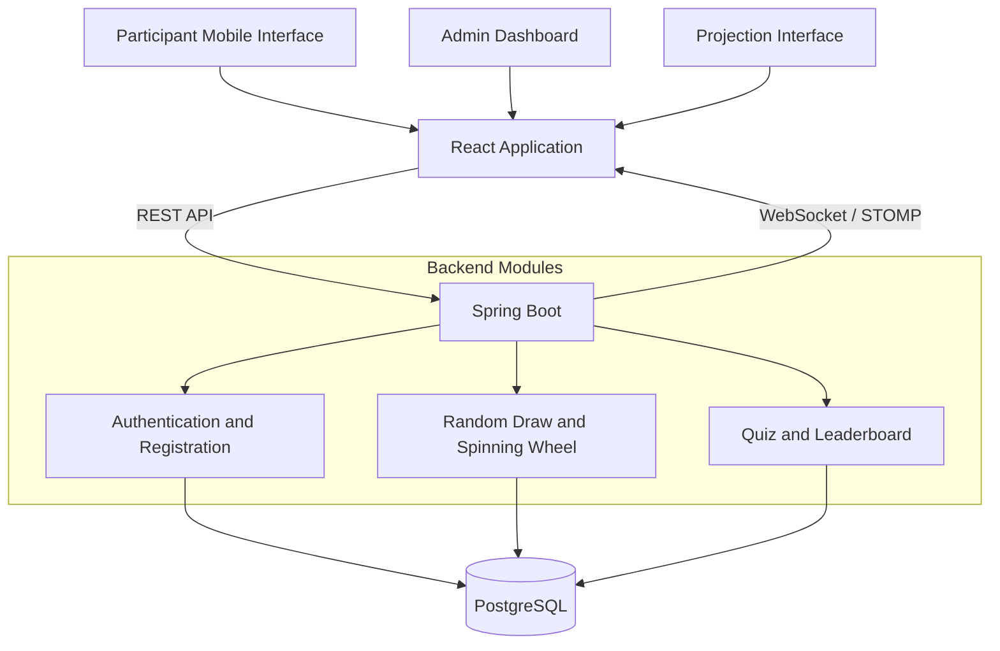

# BING BANG — Kick-off Platform


The interactive event platform for **BING BANG**, a collaborative kick-off event organized by **GDG, AWS Club and N7Geeks** at **ENSET Mohammedia**.

## Overview

BING BANG Platform centralizes participant registration, digital identification, randomized giveaways, weighted prize distribution and synchronized quizzes within a single real-time web application.

The platform provides a mobile-first participant experience, a secure administration dashboard and a proposed read-only projection interface for the event venue.

The initial MVP targets approximately 100 participants, with a one-day development window and a team of two developers.

## Features

### Participant Registration

- Scan a shared event QR code and enter first and last names.
- Receive a unique sequential participant number upon successful registration.
- Retain the assigned identity through a secure browser session.
- Access a personal digital event pass and receive selection notifications.
- Join the quiz without registering again.

### Administration Dashboard

- Secure administrator authentication and role-based access control.
- View registered participants and manage registration availability.
- Trigger random participant selection and prize spins.
- Configure gifts, stock, weights and premium growth factors.
- Create and edit quiz questions before opening the quiz.
- Control quiz progression and view results.

### Random Participant Selection

Participants are selected uniformly at random from the eligible pool. Each participant may be selected only once during the event. A selected participant receives an in-app notification in real time. Administrators must resolve the active selection by completing its spin or marking the participant absent before starting another draw.

### Weighted Spinning Wheel

Only administrators can trigger a spin for a selected participant. The backend determines the winning gift; the frontend animates the wheel toward that result.

Each gift has an initial weight, available stock, premium status and a configurable growth factor. Premium gift weights increase geometrically with the number of completed spins since the last premium win:

```text
Standard weight: w(k) = w0
Premium weight:  w(k) = w0 * min(r^k, M)
Probability:     P(i) = w(i) / sum(available weights)
```

Here, `k` is the number of consecutive non-premium spins, `r >= 1` is the growth factor, and `M >= 1` is the maximum multiplier. A standard win increments the counter; a premium win resets it. Exhausted and inactive gifts are excluded. Stock updates, result persistence and counter updates are atomic. Each draw permits at most one spin. The weighted nature of the wheel must be communicated to participants.

### Synchronized Quiz

- Administrator-managed single-answer multiple-choice questions.
- Quiz locked until explicitly opened by an administrator.
- Questions displayed simultaneously to connected participants.
- Server-controlled deadlines and question progression.
- One answer per participant per question.
- Correct answers withheld until the question closes.
- Automatic scoring and final leaderboard, with shared ranks for equal scores.

### Real-Time Communication

WebSocket/STOMP broadcasts committed state changes. REST endpoints provide authoritative state and personalized data. Clients resynchronize on reconnect, with polling as a proposed fallback when WebSocket is unavailable.

## Technology Stack

| Layer | Technology |
| --- | --- |
| Backend | Java 21, Spring Boot, Maven |
| Persistence | Spring Data JPA, Hibernate, PostgreSQL |
| Security | Spring Security, HTTP sessions, CSRF protection |
| Real-time | Spring WebSocket, STOMP |
| Database migrations | Flyway |
| Frontend | React, TypeScript, Vite |
| Styling | Tailwind CSS and shared design tokens |
| Testing | JUnit, Mockito, integration and concurrency tests |
| Infrastructure | Docker, Docker Compose, HTTPS reverse proxy |

## Architecture

The application follows a modular monolith architecture. All modules share a single backend, frontend and PostgreSQL database. PostgreSQL is the source of truth; REST handles commands and queries, while WebSocket broadcasts state changes after transactions commit.



## Repository Structure

```text
bing-bang-platform/
├── backend/
│   └── src/main/java/com/kickoff/
│       ├── auth/
│       ├── config/
│       ├── common/
│       ├── event/
│       ├── participant/
│       ├── draw/
│       ├── wheel/
│       ├── notification/
│       └── quiz/
├── frontend/
│   └── src/
│       ├── api/
│       ├── components/
│       ├── contexts/
│       ├── hooks/
│       ├── features/
│       └── pages/
├── docs/
├── docker-compose.yml
├── .env.example
├── .gitignore
└── README.md
```

This is the planned structure, not an inventory of implemented files.

## Shared Development Contracts

- Participant internal identifier: UUID; public participant number: integer.
- Roles: `ADMIN` and `PARTICIPANT`.
- REST API prefix: `/api`; WebSocket endpoint: `/ws`.
- Shared participant identity, security configuration and WebSocket infrastructure.
- JSON request and response bodies; UTC timestamps in ISO 8601 format.
- Database migrations coordinated between developers to avoid duplicate versions.
- Server-side validation and transactional handling of critical operations.
- React route guards complement, but never replace, backend authorization.

## Security and Data Integrity

- Sequential numbering must be safe under concurrent registration.
- Unique database constraints prevent duplicate participant numbers, selections, spins and quiz answers.
- Administrators authenticate using securely hashed passwords.
- Session cookies, CSRF protection and HTTPS protect authenticated operations.
- The public participant number is not an authentication credential.
- The server validates quiz deadlines, gift availability and all state transitions.
- Personal data is restricted to authorized users; public displays use participant numbers.
- Secrets and database credentials must never be committed to Git.

A browser session alone cannot guarantee that the same individual will not register from another device. Registration supervision is therefore required for the MVP.

## Design System

The frontend must follow the existing official BING BANG event identity. Logos, typography, colors, backgrounds and reusable UI components will be defined from the supplied event assets and shared by both developers. No replacement branding is assumed.

## Development Team

| Developer | Role | Responsibilities |
| --- | --- | --- |
| Noureddine Imgharn | Tech Lead — Core Platform | Architecture, security, registration, participant management, random draw, spinning wheel, shared real-time infrastructure and deployment |
| Mohammed | Co-Tech Lead — Quiz Module | Quiz data model, API, question management, synchronization, answer submission, scoring, leaderboard and quiz interfaces |

Both developers contribute to integration, testing and release preparation.

## Git Workflow

- `main` — stable, deployable branch.
- `feature/event-core` — core platform development.
- `feature/quiz` — quiz module development.

Use pull requests to integrate features and coordinate changes to shared contracts. Follow Conventional Commits, for example:

```text
feat(registration): implement sequential participant numbering
feat(quiz): implement synchronized question progression
fix(wheel): prevent duplicate prize allocation
```

## Getting Started

Planned prerequisites: Java 21, Maven or Maven Wrapper, Node.js, npm, PostgreSQL and Docker Compose (or an equivalent cloud development environment).

After the initial scaffold and Docker configuration are committed, the intended startup command is:

```bash
docker compose up --build
```

Environment variables, service URLs and exact startup instructions will be documented once the environment is initialized. No local checkout is required if using a compatible cloud IDE.

## MVP Acceptance Criteria

- 100 concurrent registrations without duplicate numbers.
- Participant identity retained on page refresh.
- No repeated participant selection or duplicate prize allocation.
- Correct stock handling and premium probability reset.
- Quiz inaccessible before opening; duplicate and late answers rejected.
- Connected clients synchronize question changes and recover after reconnecting.
- Unauthorized administrative requests rejected.
- Full event rehearsal completed before release.

## Project Status

**Planning / initialization — MVP v1.0.**

The architecture and requirements are defined. Implementation, deployment and performance validation are pending.

---

**BING BANG** · GDG × AWS Club × N7Geeks · ENSET Mohammedia
