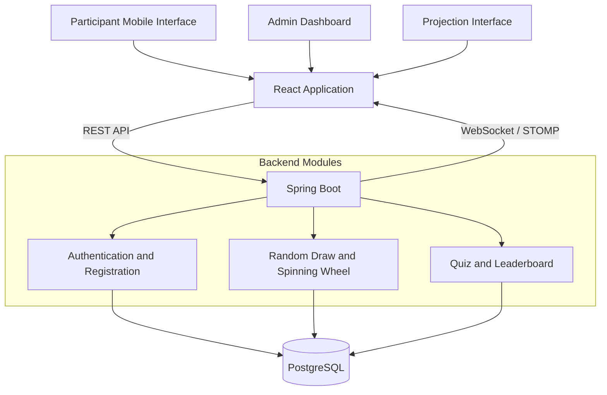

# BING BANG — Kick-off Platform


The interactive event platform for **BING BANG**, a collaborative kick-off event organized by **GDG, AWS Club and N7Geeks** at **ENSET Mohammedia**.

> **Project status:** F01 and F02 add backend administrator authentication and participant registration; F03 adds secure real-time infrastructure; F04 adds backend random draws and resettable cycles; F05 adds backend weighted prize allocation. Other business features below are planned.

## Overview

BING BANG Platform centralizes participant registration, digital identification, randomized giveaways, weighted prize distribution and synchronized quizzes within a single real-time web application.

The platform provides a mobile-first participant experience, a secure administration dashboard and a proposed read-only projection interface for the event venue.

The initial MVP targets approximately 100 participants, with a one-day development window and a team of two developers.

## Features

### Participant Registration

- Scan a shared event QR code and enter first and last names.
- Receive a unique sequential participant number upon successful registration.
- Retain the assigned identity through a secure browser session.
- Access a personal digital event pass and receive selection notifications.
- Join the quiz without registering again.

### Administration Dashboard

- Secure administrator authentication and role-based access control.
- View registered participants and manage registration availability.
- Trigger random participant selection and prize spins.
- Configure gifts, stock, weights and premium growth factors.
- Create and edit quiz questions before opening the quiz.
- Control quiz progression and view results.

### Random Participant Selection

Participants are selected uniformly at random from the eligible pool. Each participant may be selected only once during the event. A selected participant receives an in-app notification in real time. Administrators must resolve the active selection by completing its spin or marking the participant absent before starting another draw.

### Weighted Spinning Wheel

Only administrators can trigger a spin for a selected participant. The backend determines the winning gift; the frontend animates the wheel toward that result.

Each gift has an initial weight, available stock, premium status and a configurable growth factor. Premium gift weights increase geometrically with the number of completed spins since the last premium win:

```text
Standard weight: w(k) = w0
Premium weight:  w(k) = w0 * min(r^k, M)
Probability:     P(i) = w(i) / sum(available weights)
```

Here, `k` is the number of consecutive non-premium spins, `r >= 1` is the growth factor, and `M >= 1` is the maximum multiplier. A standard win increments the counter; a premium win resets it. Exhausted and inactive gifts are excluded. Stock updates, result persistence and counter updates are atomic. Each draw permits at most one spin. The weighted nature of the wheel must be communicated to participants.

### Synchronized Quiz

- Administrator-managed single-answer multiple-choice questions.
- Quiz locked until explicitly opened by an administrator.
- Questions displayed simultaneously to connected participants.
- Server-controlled deadlines and question progression.
- One answer per participant per question.
- Correct answers withheld until the question closes.
- Automatic scoring and final leaderboard, with shared ranks for equal scores.

### Real-Time Communication

WebSocket/STOMP broadcasts committed state changes. REST endpoints provide authoritative state and personalized data. Clients resynchronize on reconnect, with polling as a proposed fallback when WebSocket is unavailable.

## Technology Stack

| Layer | Technology |
| --- | --- |
| Backend | Java 21, Spring Boot, Maven |
| Persistence | Spring Data JPA, Hibernate, PostgreSQL |
| Security | Spring Security, PostgreSQL-backed HTTP sessions, BCrypt and CSRF |
| Real-time | Spring WebSocket, STOMP |
| Database migrations | Flyway |
| Frontend | React, TypeScript, Vite |
| Styling | Tailwind CSS and shared design tokens |
| Testing | JUnit, Mockito, integration and concurrency tests |
| Infrastructure | Docker, Docker Compose, HTTPS reverse proxy |

## Architecture

The application follows a modular monolith architecture. All modules share a single backend, frontend and PostgreSQL database. PostgreSQL is the source of truth; REST handles commands and queries, while WebSocket broadcasts state changes after transactions commit.



## Repository Structure

```text
bing-bang-platform/
├── backend/
│   └── src/main/java/ma/enset/bigbang/
│       ├── auth/
│       ├── config/
│       ├── common/
│       ├── event/
│       ├── participant/
│       ├── draw/
│       ├── wheel/
│       ├── notification/
│       └── quiz/
├── frontend/
│   └── src/
│       ├── api/
│       ├── components/
│       ├── contexts/
│       ├── hooks/
│       ├── features/
│       └── pages/
├── docs/
├── docker-compose.yml
├── .env.example
├── .gitignore
└── README.md
```

This is the planned structure, not an inventory of implemented files.

## Shared Development Contracts

- Participant internal identifier: UUID; public participant number: integer.
- Roles: `ADMIN` and `PARTICIPANT`.
- REST API prefix: `/api`; WebSocket endpoint: `/ws`.
- Shared participant identity, security configuration and WebSocket infrastructure.
- JSON request and response bodies; UTC timestamps in ISO 8601 format.
- Database migrations coordinated between developers to avoid duplicate versions.
- Server-side validation and transactional handling of critical operations.
- React route guards complement, but never replace, backend authorization.

## Security and Data Integrity

- Sequential numbering must be safe under concurrent registration.
- Unique database constraints prevent duplicate participant numbers, selections, spins and quiz answers.
- Administrators authenticate using securely hashed passwords.
- Session cookies, CSRF protection and HTTPS protect authenticated operations.
- The public participant number is not an authentication credential.
- The server validates quiz deadlines, gift availability and all state transitions.
- Personal data is restricted to authorized users; public displays use participant numbers.
- Secrets and database credentials must never be committed to Git.

A browser session alone cannot guarantee that the same individual will not register from another device. Registration supervision is therefore required for the MVP.

## Design System

The frontend must follow the existing official BING BANG event identity. Logos, typography, colors, backgrounds and reusable UI components will be defined from the supplied event assets and shared by both developers. No replacement branding is assumed.

## Development Team

| Developer | Role | Responsibilities |
| --- | --- | --- |
| Noureddine Imgharn | Tech Lead — Core Platform | Architecture, security, registration, participant management, random draw, spinning wheel, shared real-time infrastructure and deployment |
| Tech Lead | Quiz Module | Quiz data model, API, question management, synchronization, answer submission, scoring, leaderboard and quiz interfaces |

Both developers contribute to integration, testing and release preparation.

## Git Workflow

- `main` — stable, deployable branch.
- `feature/event-core` — core platform development.
- `feature/quiz` — quiz module development.

Use pull requests to integrate features and coordinate changes to shared contracts. Follow Conventional Commits, for example:

```text
feat(registration): implement sequential participant numbering
feat(quiz): implement synchronized question progression
fix(wheel): prevent duplicate prize allocation
```

## Getting Started

**Foundation setup is incomplete:** `frontend/package-lock.json` could not be generated in the restricted environment. Run `npm install` in `frontend/` with registry access and review the resulting lockfile before using `npm ci`, building the frontend image, or running CI.

Prerequisites: Docker with Compose, or Java 21, Maven Wrapper, Node 22.14.0 and PostgreSQL for local development. Copy `.env.example` to `.env` and replace the local database password. The Compose database is not exposed on the host; the frontend and backend bind to localhost.

```bash
cp .env.example .env
# Edit .env and replace the password before starting.
docker compose up --build -d
docker compose ps
docker compose down
```

Home: http://localhost:8088/; backend health: http://localhost:8080/actuator/health; readiness: http://localhost:8080/actuator/health/readiness. Ports can be changed in `.env`. `docker compose down` preserves the database volume.

```bash
cd backend && ./mvnw verify
cd ../frontend && npm ci && npm run lint && npm run typecheck && npm run build
```

For backend development outside Compose, run PostgreSQL and the Flyway migrations first, set `DB_URL`, `DB_USERNAME`, and `DB_PASSWORD`, then run `./mvnw spring-boot:run`. Vite's `npm run dev` proxies `/api` and `/ws` to localhost:8080. See [architecture](docs/ARCHITECTURE.md), [contracts](docs/API_CONTRACT.md), [design](docs/DESIGN_SYSTEM.md), and [contributing](docs/CONTRIBUTING.md).

## MVP Acceptance Criteria

- 100 concurrent registrations without duplicate numbers.
- Participant identity retained on page refresh.
- No repeated participant selection or duplicate prize allocation.
- Correct stock handling and premium probability reset.
- Quiz inaccessible before opening; duplicate and late answers rejected.
- Connected clients synchronize question changes and recover after reconnecting.
- Unauthorized administrative requests rejected.
- Full event rehearsal completed before release.

## Project Status

**F02 — Participant registration in development.**

The application foundation is being initialized. Business features, deployment and performance validation are pending.

---

**BING BANG** · GDG × AWS Club × N7Geeks · ENSET Mohammedia

## Administrator authentication (F01)

Authentication uses PostgreSQL-backed HTTP sessions rather than JWT. Before first startup, set both `ADMIN_USERNAME` and `ADMIN_PASSWORD` in your local `.env`; use a unique username and a strong password of 12–72 UTF-8 bytes. The password is hashed with BCrypt and is never overwritten by later starts. After bootstrap, remove these variables from `.env`. Concurrent startup is serialized in PostgreSQL. The migration container must run before the backend.

`SESSION_TIMEOUT` defaults to `30m`; `LOGIN_MAX_ATTEMPTS` to `5`; `LOGIN_WINDOW` to `15m`. `SESSION_COOKIE_SECURE` controls the development cookie; use HTTPS and the `prod` profile in production, which forces secure cookies. Cookies are HttpOnly and SameSite=Lax. The sample `.env` sets secure cookies off for local HTTP only. Never commit real credentials. The in-memory limiter counts attempts per direct peer address and is not shared across instances; reverse proxies can cause clients to share one bucket. Revisit this before multi-instance deployment.

For manual testing, with `jq` installed, start PostgreSQL, Flyway, and the backend (`docker compose up --build -d postgres flyway backend`), then obtain a CSRF token before each state-changing operation. Enter credentials interactively to avoid shell history:

```bash
read -r -p 'Admin username: ' ADMIN_LOGIN
read -r -s -p 'Admin password: ' ADMIN_SECRET; echo
TOKEN=$(curl -sS -c /tmp/bigbang-cookies http://localhost:8080/api/auth/csrf | jq -r .token)
jq -n --arg username "$ADMIN_LOGIN" --arg password "$ADMIN_SECRET" '{username:$username,password:$password}' |
  curl -sS -b /tmp/bigbang-cookies -c /tmp/bigbang-cookies -H 'Content-Type: application/json' -H "X-CSRF-TOKEN: $TOKEN" --data-binary @- http://localhost:8080/api/auth/admin/login
unset ADMIN_SECRET
curl -sS -b /tmp/bigbang-cookies http://localhost:8080/api/auth/me
TOKEN=$(curl -sS -b /tmp/bigbang-cookies -c /tmp/bigbang-cookies http://localhost:8080/api/auth/csrf | jq -r .token)
curl -i -b /tmp/bigbang-cookies -c /tmp/bigbang-cookies -X POST -H "X-CSRF-TOKEN: $TOKEN" http://localhost:8080/api/auth/logout
curl -i -b /tmp/bigbang-cookies http://localhost:8080/api/auth/me
rm -f /tmp/bigbang-cookies
```

See [API contracts](docs/API_CONTRACT.md) for response codes. CSRF is required for login and logout, and a fresh token is needed after each. No participant registration or quiz functionality is included.


## Participant registration (F02)

Registration accepts first and last names only. A PostgreSQL sequence assigns a positive unique number; rollbacks can cause gaps. A successful registration authenticates the participant in the existing JDBC-backed session. Repeated registration in the same established session returns the existing participant. Identical names are allowed. A new browser or lost session cannot be linked reliably to the same person.

With the backend running and `jq` installed, a minimal local test is:

```bash
TOKEN=$(curl -sS -c /tmp/bigbang-participant-cookies http://localhost:8080/api/auth/csrf | jq -r .token)
curl -sS -b /tmp/bigbang-participant-cookies -c /tmp/bigbang-participant-cookies \
  -H 'Content-Type: application/json' -H "X-CSRF-TOKEN: $TOKEN" \
  -d '{"firstName":"Ahmed","lastName":"Alami"}' http://localhost:8080/api/participants/register
curl -sS -b /tmp/bigbang-participant-cookies http://localhost:8080/api/participants/me
curl -sS -b /tmp/bigbang-participant-cookies http://localhost:8080/api/auth/me
# Fetch a fresh CSRF token after registration before further POST requests.
rm -f /tmp/bigbang-participant-cookies
```

Administrators can use `GET /api/admin/participants?page=0&size=20` and `GET /api/admin/participants/count` with an authenticated admin session. See [API contracts](docs/API_CONTRACT.md) for statuses and response shapes.


## Real-time infrastructure (F03)

The backend provides session-authenticated STOMP over `/ws`, with CSRF required on CONNECT. Role-restricted subscriptions and typed after-commit events are documented in [REALTIME_CONTRACT.md](docs/REALTIME_CONTRACT.md), including manual testing and reconnection. Only new participant registration currently emits a business notification, to administrators. WebSocket delivery is best-effort; use REST for authoritative state. Configure `WS_ALLOWED_ORIGINS` with exact browser origins; production requires HTTPS/WSS. The in-process broker requires a single backend instance until cross-instance delivery is designed.


## Random draw engine (F04)

Admins can start and cancel one active draw and reset eligibility by creating a new cycle. PostgreSQL locks and constraints protect concurrency and preserve history; cancelled participants remain selected until reset. Selection is uniform using `SecureRandom` over the eligible UUIDs, independently of any future weighted prize wheel. All mutations require the existing admin session and CSRF token. The initial cycle is 1. See [draw API](docs/API_CONTRACT.md), [architecture](docs/ARCHITECTURE.md), and [real-time contract](docs/REALTIME_CONTRACT.md). Full PostgreSQL concurrency and WebSocket integration tests remain to be run in F07.

After authenticating as admin using the earlier cookie-jar instructions, obtain a fresh token and run:

```bash
TOKEN=$(curl -sS -b /tmp/bigbang-cookies -c /tmp/bigbang-cookies http://localhost:8080/api/auth/csrf | jq -r .token)
curl -sS -b /tmp/bigbang-cookies -H "X-CSRF-TOKEN: $TOKEN" -X POST http://localhost:8080/api/admin/draw/start
curl -sS -b /tmp/bigbang-cookies http://localhost:8080/api/admin/draw/status
# Cancel the active draw using its returned ID, then reset the expected cycle.
curl -sS -b /tmp/bigbang-cookies -H "X-CSRF-TOKEN: $TOKEN" -X POST http://localhost:8080/api/admin/draw/DRAW_UUID/cancel
curl -sS -b /tmp/bigbang-cookies -H 'Content-Type: application/json' -H "X-CSRF-TOKEN: $TOKEN" -d '{"confirmed":true,"expectedCycleNumber":1}' http://localhost:8080/api/admin/draw/reset
curl -sS -b /tmp/bigbang-cookies http://localhost:8080/api/admin/draw/history
```

The sample uses the admin cookie jar before logout. Completion is internal to a future prize-allocation transaction; no endpoint can mark a draw completed.


## Weighted prize wheel (F05)

Admins configure STANDARD/PREMIUM prizes, weights, stock and progression, then spin a specified active draw. The server stores the weighted result, decrements stock and completes the draw atomically. Retrying a draw returns its existing award. The participant can recover their own awards after reconnecting. See [prize wheel](docs/PRIZE_WHEEL.md) for formulas, API examples, lock order, snapshots and deferred tests. The backend is implemented but has not yet passed integration validation.

## Quiz developer onboarding

The Tech Lead owns Quiz. F06.1 adds the domain and V7 schema; administrative preparation and lifecycle APIs plus participant-safe status are implemented; answer APIs and screens are not yet implemented. Follow [Quiz integration and developer setup](docs/QUIZ_INTEGRATION.md) for both Compose workflows, Git steps, shared identity and STOMP services, proposed routes, migration reservations and test expectations. V7–V19 are reserved for Quiz; coordinate deployment order. The optional `compose.local.yaml` exposes PostgreSQL on localhost only for running Spring Boot outside Docker.

### Participant registration (P01)

Open `/` to register with first and last name. Existing participant sessions go to `/participant`, the participant home and digital pass showing the actual assigned number. An administrator session is never replaced. The frontend checks `/api/auth/me`, submits to `/api/participants/register`, and uses the shared API client to obtain and send CSRF tokens with session cookies. Names are trimmed and limited to 100 characters. A failed submission can be retried manually; it is never automatically repeated.

The implementation lives in `frontend/src/features/participant`; the partner-logo strip and poster artwork crops are in `frontend/src/assets/participant`. Run the local Vite development server with `cd frontend && npm run dev` and open the URL it prints (normally http://localhost:5173/); the backend and database must also be running for session checking and registration. Browser-level layout and live backend registration still require verification in an environment that permits a local server.

### Participant home (P02)

`/participant` requires a participant session and shows the backend identity, ticket-style pass, three club logos, and draw eligibility from `/api/participants/me/draw`. The official five-logo header and club crops are under `frontend/src/assets/participant`; event artwork reuses P01. Registration confirmation appears only after a newly created registration and is cleared from navigation state. The My Pass link scrolls to the existing pass; Quiz and Draw links scroll to honest placeholders pending their screens. No QR verification is implemented.

The shared STOMP service subscribes to the private queue and draw topic, deduplicates received events, refreshes draw state after events and reconnection, and polls every 30 seconds while the page is visible. WebSocket delivery is best effort; missed private notices are not replayed. Session, REST, and WebSocket behavior requires live backend and browser integration verification.

P02 checks in the current development environment: frontend lint, TypeScript, shared tests and production build passed. A visual comparison and live REST/STOMP integration test were blocked because the development server could not bind to localhost (`EPERM`); they remain necessary before treating the screen as fully validated.

### Administrator login (A01)

Visit `/admin/login` to authenticate with the administrator username and password provisioned by the backend. `/admin` is the protected administrator dashboard. The page reuses the session context, verifies the server's ADMIN identity after login, and refuses to intentionally replace an existing participant session; the participant must explicitly sign out first. Authentication and logout use the shared cookie-enabled API client, which obtains a fresh CSRF token for each mutation. No credentials are stored in browser storage and failed credential requests are not retried automatically.

For local testing, start PostgreSQL, Flyway and the backend as documented above, then run `cd frontend && npm run dev` and open `http://localhost:5173/admin/login`. Check anonymous, participant, administrator, logout and expired-session behavior with separate browser sessions. Browser and live backend verification are still required. The frontend's session pre-check cannot make identity switching atomic across simultaneous tabs: the current backend login endpoint accepts an existing authenticated participant, so a server-side guard and concurrency validation are needed for a strict cross-tab guarantee.

### Administrator dashboard (A02)

`/admin` uses the shared ADMIN route guard and `frontend/src/features/admin/AdminLayout.tsx` for its responsive sidebar. The four KPI cards use `/api/admin/participants/count`, `/api/admin/draw/status`, and enabled, positive stock from `/api/admin/prizes`. The draw action calls `POST /api/admin/draw/start` with the shared CSRF/session client. Active draw details come from the admin draw status response; that endpoint does not include the last completed or cancelled draw when no draw is active.

The dashboard listens on `/topic/admin` and `/topic/draw`, deduplicates events and resynchronizes REST state on relevant events and reconnect. It does not poll; live updates are best effort. Draw controls are paused while the real-time connection is unavailable and whenever authoritative draw state is unavailable. Quiz administration remains a future interface. Browser, live REST/STOMP and responsive visual checks remain necessary.

### Lucky Draw management (A03)

The ADMIN-only frontend at `/admin/draw` reuses the A02 layout, session, CSRF client and STOMP service. It retrieves participant count, current-cycle status and bounded draw history from REST. Starting a draw never chooses a participant in JavaScript. Cancellation and cycle reset require confirmation: cancelling keeps the participant selected for the current cycle; resetting creates a new cycle while preserving history, awards, stock and premium progression. Mutations are never retried automatically; state is refreshed even after an uncertain response. The Prize Wheel interface is available to administrators at `/admin/wheel`.

Relevant `/topic/admin` and `/topic/draw` events and reconnections trigger REST refreshes. Actions are paused while live updates or authoritative state are unavailable. To verify locally, start the backend and database, run `cd frontend && npm run dev`, then open `http://localhost:5173/admin/draw` in an authenticated administrator session. Live backend and visual browser verification remain outstanding.

### Administrator prize wheel (A04)

`/admin/wheel` uses the A02 header and ADMIN route guard. `/api/admin/wheel/status` provides the active draw and eligible segments; `/api/admin/wheel/spin` allocates a prize using its draw ID. A fixed pointer and equal-sized SVG sectors animate to the backend-selected segment; equal sectors are explicitly disclosed as not representing weighted chances. Reduced motion skips the long rotation. The participant receives the existing backend notification after commit, which may precede the visual animation.

The displayed segments stay frozen through the animation. If inventory changes and the winning prize is not in the original snapshot, the actual award is shown without a misleading animation. An in-tab session-storage draw ID permits `/api/admin/wheel/history` recovery after an uncertain response or page refresh; no spin is automatically retried. Backend draw/award uniqueness remains the final concurrency protection. Pending recovery requires session storage; no credentials are stored there. To test, start the database and backend, then `cd frontend && npm run dev` and open `http://localhost:5173/admin/wheel` with an administrator session and active draw. Browser animation and live backend verification remain outstanding.

### Prize and inventory management (A05)

The ADMIN-only `/admin/prizes` interface uses the shared administrator header, session, CSRF client and STOMP service. It lists and searches backend prizes; supports creation, editing, activation and deactivation; and adjusts stock through the audited stock endpoint with a required reason. Initial stock records the original amount; subsequent adjustments change remaining stock without modifying award snapshots. Premium growth factor (1–100) and multiplier (1–1000) are saved explicitly without resetting progression. Failed or uncertain mutations are not automatically retried; server state must refresh before further changes. The dashboard and wheel receive existing after-commit inventory events and reload REST state.

For local verification, run the database and backend, then `cd frontend && npm run dev` and open `http://localhost:5173/admin/prizes` in an administrator session. Browser and live backend verification are still required.

### Participant management (A06)

`/admin/participants` is a read-only ADMIN interface using the shared administrator layout and session. It retrieves the list with sequential bounded `/api/admin/participants` pages and the total from `/api/admin/participants/count`. Names and public numbers are searchable across all retrieved pages, and results are displayed 20 at a time. Registration events on `/topic/admin` and reconnection trigger REST resynchronization; search and the nearest valid page are preserved. The current response does not contain registration timestamps, so no date column is shown.

For local verification, start the backend and database, run `cd frontend && npm run dev`, and open `http://localhost:5173/admin/participants` with an administrator session. Live browser and backend validation remain necessary. Page reads are separate requests, so changes during a multi-page refresh are not a single database snapshot; registration events and reconnects initiate another refresh.

### Quiz foundation (F06.1)

`V7__quiz_foundation.sql` and JPA entities provide Quiz session, ordered questions and options, and participant answers. Database constraints prevent duplicate answers and invalid option/question references; future transactional services must enforce publication validity, deadlines, lifecycle and scoring. See [Quiz domain model](docs/QUIZ_DOMAIN_MODEL.md). PostgreSQL migration and JPA integration remain unverified in the restricted environment.

### Quiz preparation API (F06.2)

Administrators can create one DRAFT event quiz, edit its title and manage ordered questions and answer options using `/api/admin/quiz`. Each question has 2–10 unique options and exactly one correct option. Mutations require the current quiz `expectedVersion` and CSRF. The readiness endpoint checks preparation without launching the quiz. PostgreSQL-backed transaction locks protect creation and question mutations; see [API contracts](docs/API_CONTRACT.md). Lifecycle, participant answers and results remain future work. Maven, PostgreSQL and live API verification remain outstanding in the restricted environment.

### Quiz lifecycle (F06.3)

The ADMIN Quiz lifecycle opens and closes ordered questions using persisted server deadlines and a shared expiry scheduler; `/api/quiz/status` returns participant-safe current state. V8 retains per-question timing. See [Quiz lifecycle](docs/QUIZ_LIFECYCLE.md) for endpoints, locking and restart behavior. Answers, scoring, results and Quiz event publication remain future work. PostgreSQL migration and runtime integration are not yet verified.


F06.4 adds participant answer submission, idempotent recovery, closed-question feedback and fixed scoring, plus administrator answer counts. See [Quiz answer and scoring](docs/QUIZ_ANSWER_AND_SCORING.md) for endpoints, roles, concurrency and verification limitations. Leaderboard and complete Quiz real-time synchronization remain pending.
