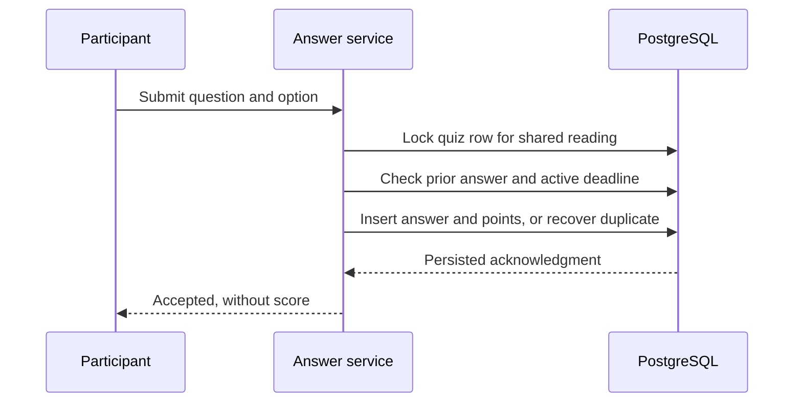

# Quiz answer submission and scoring (F06.4)

Participants authenticate through the existing JDBC session; their principal supplies the participant UUID. All endpoints require the existing role and CSRF protections. No participant identifier, score, correctness flag or client timestamp is accepted in the request.

- `POST /api/quiz/answers` (PARTICIPANT, CSRF): `{"questionId":"<uuid>","optionId":"<uuid>"}`. A new answer returns 201; an identical retry returns 200, including after closure. The response is `{"questionId":"<uuid>","selectedOptionId":"<uuid>","status":"ACCEPTED","submittedAt":"<instant>"}`. A retry with a different option returns 409 `ANSWER_ALREADY_SUBMITTED`.
- `GET /api/quiz/questions/{questionId}/answer` (PARTICIPANT): the authenticated participant's acknowledgment, or 404 `ANSWER_NOT_FOUND`.
- `GET /api/quiz/questions/{questionId}/feedback` (PARTICIPANT): 404 `ANSWER_FEEDBACK_UNAVAILABLE` until that question is recorded closed. Afterwards it returns `questionId`, `selectedOptionId`, `correctOptionId`, `hasAnswered`, nullable `correct`, `awardedPoints` and `questionPoints`. An unanswered question has null selection/correctness and zero points. Historical questions remain visible through their persistent timing records. Legacy completed questions lacking timing records have no feedback until a separate recovery policy is implemented.
- `GET /api/quiz/status` (PARTICIPANT) adds `hasAnswered`, `selectedOptionId` and `canSubmitAnswer`; it never exposes active-question correctness or scores.
- `GET /api/admin/quiz/questions/{questionId}/statistics` (ADMIN) returns `questionId`, `submittedAnswers` and `registeredParticipants`. Registration does not imply quiz participation or online presence.

Malformed inputs are 400; authentication/role/CSRF errors are 401/403; unavailable resources are 404; a mismatched or closed question, expired deadline, or conflicting retry is 409. See the API error body for its code. Correct option membership is checked by the service and by the existing composite foreign key. Question and participant uniqueness is enforced in PostgreSQL.

The transaction refreshes the quiz under a pessimistic read lock, then reads server `Clock` time; new submissions require time strictly before the stored deadline. Lifecycle mutations take the conflicting exclusive lock, so a manual or scheduled close cannot pass an admitted transaction. The unique constraint and `INSERT ... ON CONFLICT DO NOTHING` resolve simultaneous duplicates without continuing in an aborted transaction. The server stores configured question points for a correct answer and zero for an incorrect answer. No answer row contributes zero. Stored awards are historical snapshots. Database locking and simultaneous request behavior still require verification against PostgreSQL in the target environment.

No per-answer WebSocket event is published in this milestone. Future F06.6 events must be after commit and must not broadcast answers or early correctness. Leaderboard and final results remain pending. Unit, PostgreSQL and HTTP/security test sources are provided; execution depends on the local Maven and PostgreSQL environment.

## Local verification

Run `cd backend && ./mvnw clean verify`. `PostgresQuizAnswerTest` is enabled only when `F06_TEST_DB_URL`, `F06_TEST_DB_USER` and `F06_TEST_DB_PASSWORD` point to a disposable PostgreSQL test database whose user can create and drop its isolated test schema. Run `git diff --check` and `docker compose config --quiet` from the repository root. Exercise the endpoints with separate authenticated participant and administrator sessions and CSRF tokens once the backend is running; never use a production database for race tests.
