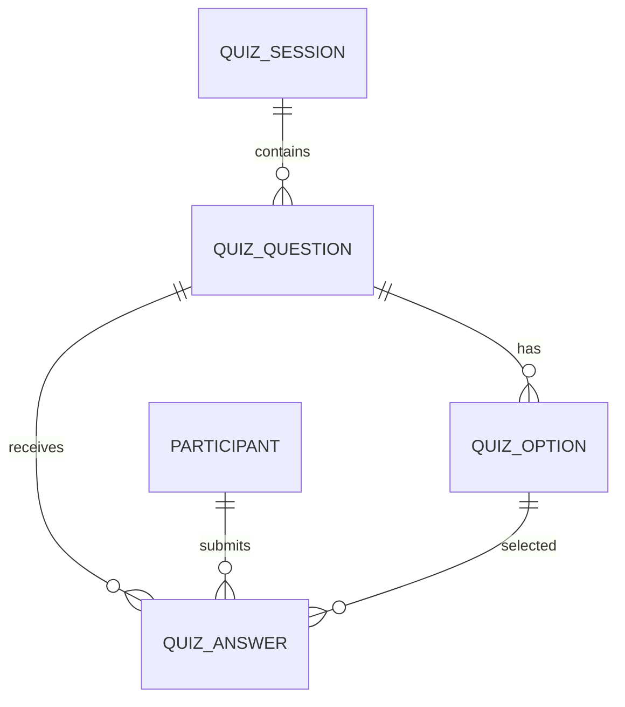
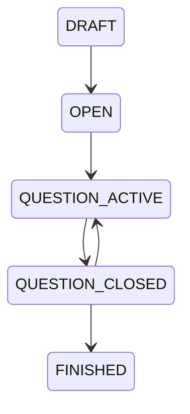

# Quiz domain foundation (F06.1)

The Tech Lead owns the Quiz module, including backend, frontend, migrations, tests and integration, superseding earlier ownership instructions. Existing work by Mohammed must be preserved if discovered. F06.1 adds persistence; F06.2 adds administrative DRAFT preparation services and controllers. F06.3 implements lifecycle execution; answer admission, scoring/leaderboard services, messaging and UI remain unimplemented.

These transitions are enforced by the F06.3 lifecycle service. V7 stores quiz, questions, options and answers. UUIDs are internal; answers reference the existing participant UUID. The current question, opening time and deadline persist in the session. SQL restricts status/timestamp combinations and ensures current question belongs to the same quiz. It does not enforce the transition graph, deadline admission or all temporal relationships: those belong to transactional services.

V7 enforces unique question positions per session and option positions per question, positive positions/duration/points, nonblank text, one correct option **at most** via a partial unique index, one answer per participant/question, nonnegative awarded points and a composite FK ensuring the selected option belongs to the answered question. A partial unique index permits only one OPEN, QUESTION_ACTIVE or QUESTION_CLOSED session. Multiple drafts are allowed. Foreign keys use RESTRICT; history is not cascaded away. The schema does **not** enforce at least two options or the existence of a correct option: question finalization/publication must validate both and exactly one correct answer in a transaction. Prevent edits after launch in that service. Correct flags must never reach participant APIs while the question is open.

Suggested MVP defaults are 30 seconds and 100 fixed points, not an implemented service policy. Accepted answers store a server-generated submission time and immutable awarded points. The backend must assign question points for correct answers and zero for incorrect ones; unanswered means zero. Repository sums cover participants with answers only. A future leaderboard must left-join the eligible participant population so zero-score participants are not lost; the precise participation policy remains open. Equal scores share rank; suggested competition ranks are 1, 2, 2, 4, with no speed tie-breaker.

For concurrency, lifecycle mutations lock the session row with `findByIdForUpdate` (pessimistic write). Answer transactions acquire the same session with `findByIdForAnswer` (pessimistic read/shared), check active question and database-authoritative deadline, then validate option and insert the answer in that transaction. PostgreSQL's unique and composite foreign keys are the final barrier. Shared session row locks permit concurrent answers while excluding a closing writer; do not take a global write lock per answer. Establish a consistent order: session row, question/option validation, answer insertion; lock additional resources only after the session. Simultaneous activation of separate drafts is finally constrained by the active-session partial index. The answer service translates duplicate conflicts into domain errors. Verify locking and clock semantics under actual PostgreSQL before production use.

Tests include constructor unit tests and opt-in PostgreSQL constraints and JPA repository tests using isolated schemas (`F06_TEST_DB_URL`, `F06_TEST_DB_USER`, `F06_TEST_DB_PASSWORD`). V7 remains owned by standalone Flyway; tests run SQL in temporary schemas but do not themselves validate Flyway. V8 adds lifecycle timing; V9–V19 remain reserved for coordinated Quiz migrations. Do not assume migration, Hibernate validation or integration tests have passed until executed against PostgreSQL.

## F06.2 preparation services

Quiz creation serializes through a PostgreSQL advisory transaction lock. Question, title, delete and reorder operations lock the quiz row first, reject non-DRAFT status and compare the supplied aggregate version. Mutations update the version, options are replaced atomically, and reorder uses two positive-position passes to avoid transient uniqueness violations. F06.3 must acquire the same session row write lock and revalidate readiness before starting. Admin API constraints and request examples are in [API_CONTRACT.md](API_CONTRACT.md). Database integration and locking have not yet been validated in this environment.

## F06.3 lifecycle

V8 adds per-question timing and a persisted closing cutoff. The lifecycle service implements the state transitions shown above, and a scheduled reconciliation closes expired active questions without restarting deadlines. See [QUIZ_LIFECYCLE.md](QUIZ_LIFECYCLE.md) for locking, participant-safe API, V8 legacy-row handling and validation limits.

F06.4 uses the existing answer uniqueness and composite option foreign key; it persists fixed awarded points and uses `quiz_question_timings.closed_at` for historical feedback. See [QUIZ_ANSWER_AND_SCORING.md](QUIZ_ANSWER_AND_SCORING.md).
