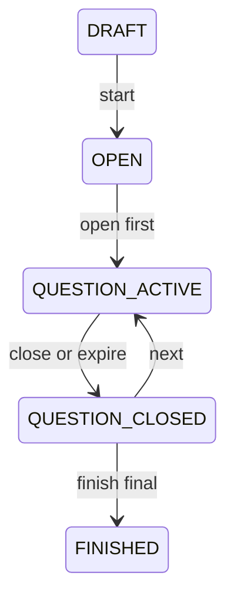

# Quiz lifecycle and timing (F06.3)

ADMIN mutations use the shared HTTP session and CSRF. Start/open accept `{"expectedVersion":0}`; close/next/finish accept `{"expectedQuestionId":"<uuid>","expectedVersion":1}`. Each returns the authoritative administrator state with lifecycle version, current question metadata, opening, deadline and closing instants, server time, next-question availability and allowed actions. Retrieve a new version after each transition. A stale ID/version or invalid state returns 409. No operation accepts a client-provided deadline or arbitrary next question.

| Method | Endpoint | Meaning |
| --- | --- | --- |
| POST | `/api/admin/quiz/start` | Revalidate readiness under lock and enter OPEN |
| POST | `/api/admin/quiz/questions/open` | Open the first question |
| POST | `/api/admin/quiz/questions/close` | Close the expected active question |
| POST | `/api/admin/quiz/questions/next` | Open the next ordered question after closure |
| POST | `/api/admin/quiz/finish` | Finish only after the last question closes |
| GET | `/api/admin/quiz/status` | Administrator state |
| GET | `/api/quiz/status` | PARTICIPANT-only safe state |

The participant DTO contains only the current question and ordered option IDs/text while active; it never contains correct flags, future question text or other participants' answers. It returns no correction after close. Admin preparation endpoints remain ADMIN-only. Security configuration denies everything else by default.

Opening stores UTC instants from the server Clock; the persisted deadline is `openedAt + durationSeconds`. `app.quiz.expiry-poll-ms` defaults to 1000 ms and `app.quiz.expiry-initial-delay-ms` defaults to 0. A shared Spring scheduled task scans persisted expired sessions, rechecks the session row and question UUID under a pessimistic write lock, and closes exactly once. Delayed expiration records the original deadline as the cutoff. Manual close records the earlier of server time and deadline. It never automatically advances. On restart the same scan reconciles an expired persisted question; unexpired deadlines are not restarted. Multi-instance closing is serialized by PostgreSQL, but the existing simple message broker remains single-instance.

V8 adds `question_closed_at` and `quiz_question_timings` so each opened question retains opening, deadline and closing times. The new session CHECK is `NOT VALID` to preserve pre-V8 historical rows whose close time was never stored; PostgreSQL still checks new or updated rows. No old close time is invented. An active pre-V8 question is added to timing history using its persisted timestamps when closed. Legacy already-closed questions may have no historical cutoff. Operators should review legacy rows before validating the new constraint. Neither V7 nor earlier migrations were modified.

Question editing and lifecycle transitions lock the same session row; the F06.2 lock path now refreshes the managed entity after locking to avoid stale first-level cache state. The F06.4 answer transaction takes a shared lock (`findByIdForAnswer`), re-reads the active question and persisted deadline after acquiring the lock, uses a trusted server acceptance time **strictly before** the deadline, and inserts under the existing uniqueness constraint before releasing the lock. A concurrent exclusive closing transition must wait for admitted answer transactions. Align clocks on all application instances and verify the database/clock boundary in integration tests. Clock is injected for deterministic tests; it is server time, not a client-provided timestamp.

Participant answer submission and fixed scoring are implemented in F06.4; administrator leaderboard and personal results are implemented in F06.5; F06.6 publishes non-sensitive lifecycle events after commit for both scheduler and REST transitions. Maven, V8 execution, Hibernate schema validation, PostgreSQL races, restart recovery and live HTTP/security behavior remain unverified until run in an integration environment.

F06.4 answer and feedback endpoints use the existing lifecycle timing records and role boundaries. See [QUIZ_ANSWER_AND_SCORING.md](QUIZ_ANSWER_AND_SCORING.md).

F06.5 exposes final results only after FINISHED. See [QUIZ_RESULTS_AND_LEADERBOARD.md](QUIZ_RESULTS_AND_LEADERBOARD.md).

F06.6 publishes committed lifecycle invalidations including persisted revisions and deadlines, including scheduler closures. See [QUIZ_REALTIME_SYNCHRONIZATION.md](QUIZ_REALTIME_SYNCHRONIZATION.md).
