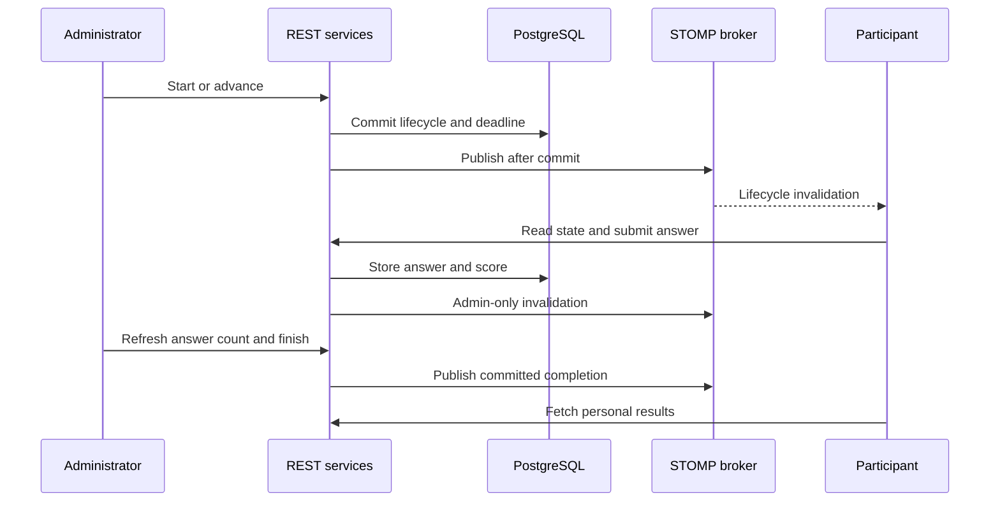

# Quiz real-time synchronization

REST commands and PostgreSQL are authoritative; STOMP notifications are best-effort invalidations. The existing envelope contains `eventId`, `type`, `timestamp`, schema `version` (currently 1) and `payload`. Lifecycle revision is a separate persisted value.

| Destination | ADMIN | PARTICIPANT | Events |
| --- | --- | --- | --- |
| `/topic/quiz` | yes | yes | `QUIZ_OPENED`, `QUESTION_OPENED`, `QUESTION_CLOSED`, `QUIZ_FINISHED` |
| `/topic/admin` | yes | no | `QUIZ_CONFIGURATION_UPDATED`, `QUIZ_ANSWER_COUNT_UPDATED` |
| `/user/queue/notifications` | own | own | Existing private notifications; no quiz answer acknowledgment |

Lifecycle payload fields: `quizId`, `status`, `questionId`, `questionPosition`, `totalQuestions`, `quizOpenedAt`, `openedAt`, `deadline`, `closedAt`, `finishedAt`, `lifecycleVersion`. Timestamps and current question fields may be null. `openedAt` and `deadline` are for the current question. Admin invalidation fields: `quizId`, `questionId` and `lifecycleVersion`; configuration invalidations have a null question. `QUIZ_OPENED` means quiz started; `QUESTION_OPENED` covers the first and subsequent questions. Payloads contain no question content, answers, scores, ranks or winner identities.

The existing application event infrastructure registers events inside the transaction and delivers only after commit; rollback sends nothing. The scheduler calls the proxied transactional lifecycle service, which emits only when it closes the current expired question. Only newly inserted answers generate an administrator invalidation; duplicate recovery does not. Admin clients should debounce bursts (e.g. 250–500 ms), then retrieve `/api/admin/quiz/questions/{id}/statistics`. Several answers can share a lifecycle revision; do not deduplicate answer invalidations by that revision.

Authenticate with the existing session, send the fresh CSRF token on STOMP CONNECT, subscribe, then fetch REST state. Participant `/api/quiz/status` includes `quizId`, `lifecycleVersion`, active question, deadline, `serverTime`, and the participant's answer state. Admin `/api/admin/quiz/status` includes revision and allowed actions. No event extends a deadline.

Deduplicate lifecycle events by `eventId`; discard older lifecycle revisions for the same quiz and refresh REST on gaps or uncertainty. Subscribe before reading state; track events arriving during the request and refresh again if the response revision is older. Repeat on reconnect; use low-frequency REST reconciliation, e.g. 30 seconds while visible and disconnected. Answer-count invalidations sharing a revision must still trigger a coalesced refresh. No historical event replay is required.

A07 will fetch admin state and counts; A08 retrieves the protected leaderboard; P05 restores current question and own answer through REST; P06 retrieves only personal unranked results. These interfaces remain pending. The simple broker is non-durable and single-instance; a crash after commit may lose notifications. No migration, countdown stream, outbox or frontend interface is added. Unit and transaction tests cover event registration and after-commit delivery; live PostgreSQL, WebSocket and smoke validation require a running test environment.
